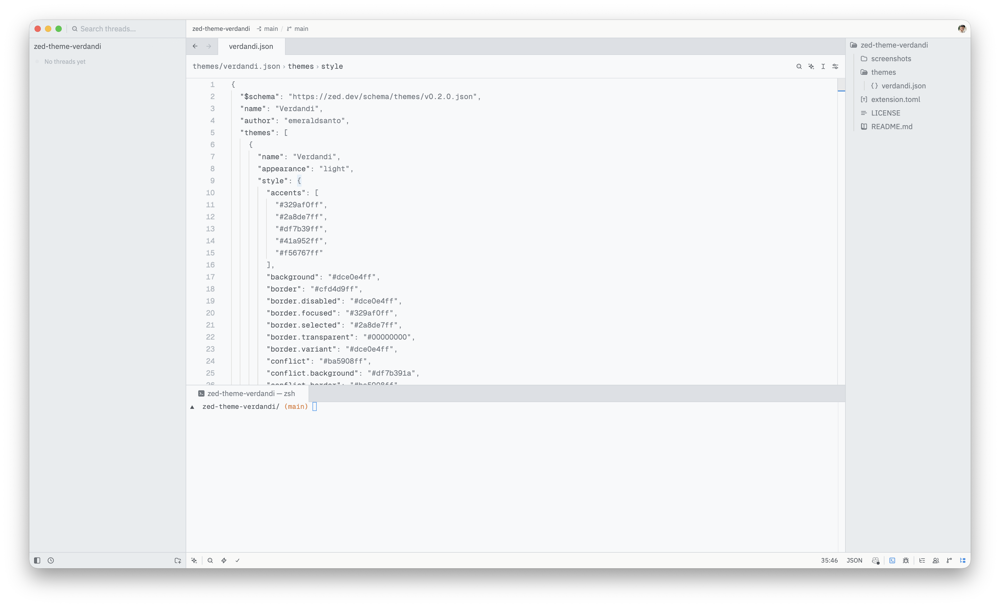
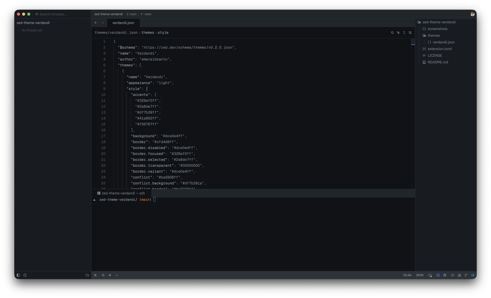

# Verdandi Theme for Zed

A monochrome theme that can live without color, for [Zed](https://zed.dev).

Includes two variants:

- **Verdandi** (light)
- **Verdandi Alter** (dark)

## Screenshots

### Verdandi

### Verdandi Alter

## Installation

Open the Extensions page in Zed (`zed: extensions`), search for "Verdandi Theme" and install it.
Then select a theme with `theme selector: toggle`.

## Credits

Ported from [Verdandi](https://github.com/be5invis/vsc-theme-verdandi) for VS Code by Renzhi Li ([be5invis](https://github.com/be5invis)).

## License

[MIT](./LICENSE)
